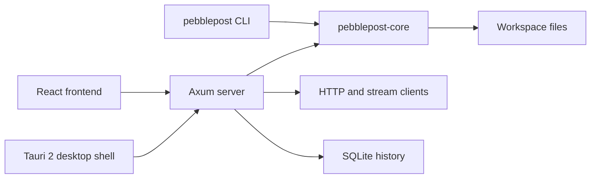

# Architecture

PebblePost is being migrated from its original backend to a Rust workspace. The frontend remains React and TypeScript.

## Workspace layout

- `crates/pebblepost-core/` owns workspace files, path validation, request inheritance, environment merging, interpolation, cookies, and examples.
- `apps/pebblepost-server/` exposes the local Axum API and serves the built frontend. It owns HTTP execution, history, import/export, docs, mock server, OpenAPI sync, and stream routes.
- `apps/pebblepost-cli/` provides workspace setup and inspection, collection import/export, docs generation, and the local server command.
- `apps/pebblepost-desktop/src-tauri/` embeds the server in a Tauri 2 shell and provides native window and directory-picker commands.
- `web/` contains the React UI, browser tests, and production assets.

## Request lifecycle

The UI sends a request definition and workspace context to the server. The server resolves inherited folder settings, combines public and secret environment files, interpolates variables, constructs a network request, streams large response bodies to temporary files, records history, and returns response metadata. WebSocket and SSE requests use `/api/stream/*` and deliver log and status events as server-sent events.

## Migration status

The Rust server executes request and folder scripts for standard request execution and collection runs, and provides gRPC endpoints. Update checks, settings, signature verification, archive extraction, and binary replacement are implemented; platform lifecycle behavior still needs comparison. Script hooks for persistent WebSocket/SSE connections remain unfinished. OS keychain storage is implemented in the Rust core and still needs cross-platform comparison. The legacy Go source is still present until the remaining backend behaviors have Rust parity.
